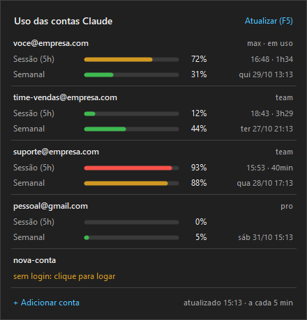

# Claude Usage Tray

Monitor para Windows que fica ao lado do relógio, na barra de tarefas, e mostra o uso dos limites do plano Claude (sessão de 5h e semanal) de **várias contas ao mesmo tempo**, avisa quando uma conta está chegando no limite e troca a conta usada pelo Claude Code com um clique.



## Recursos

- **Ícone ao lado do relógio** com uma barrinha por conta, preenchida pelo limite mais apertado dela: verde (< 70%), amarelo (70–90%), vermelho (≥ 90%).
- **Painel** (clique esquerdo no ícone) com a sessão de 5h, o limite semanal e outros limites que o plano tiver, mostrando a porcentagem e quando cada um reseta.
- **Notificações** quando uma conta passa de 80%, chega a 100% e quando é liberada de novo.
- **Troca rápida de conta**: a conta escolhida passa a ser a padrão do Claude Code, mantendo suas configurações, plugins e histórico do `~/.claude`.
- **Sugestão automática**: quando a conta em uso passa de 80%, a notificação oferece trocar para a conta com mais folga.
- **Renovação de token**: o app renova os tokens OAuth que vencem (eles duram cerca de 8h), então contas paradas continuam aparecendo.
- **Inicia com o Windows** (ativado na primeira execução, dá pra desligar no menu).

## Requisitos

- Windows 10 ou 11
- .NET Framework 4.x, que já vem com o Windows (não precisa instalar SDK)
- [Claude Code](https://code.claude.com) instalado (`claude` no PATH) e contas Claude com plano Pro, Max ou Team

## Instalação

```powershell
git clone https://github.com/caiosoares1/claude-usage-tray.git
cd claude-usage-tray
.\build.ps1
.\ClaudeUsageTray.exe
```

O `build.ps1` compila com o `csc.exe` que vem com o .NET Framework e gera o `ClaudeUsageTray.exe` na pasta do projeto. Na primeira execução o app se registra para iniciar com o Windows, apontando para esse `.exe`. Se você mover o arquivo, abra-o uma vez do novo lugar e o caminho é atualizado.

Se o ícone cair na área de ícones ocultos (a setinha `^` da barra de tarefas), arraste-o para a barra para deixá-lo sempre visível.

## Adicionando contas

A conta logada no Claude Code (`~/.claude`) aparece automaticamente. Para as outras:

1. Clique direito no ícone e escolha **Adicionar conta...**
2. Dê um nome curto (vira a pasta `%USERPROFILE%\.claude-contas\<nome>`).
3. Abre um terminal com `claude auth login`: faça o login com a conta desejada.

> O login usa a conta que estiver aberta no navegador. Antes de autorizar, troque de conta no claude.ai ou abra o link numa janela anônima.

Cada pasta em `.claude-contas` é um `CLAUDE_CONFIG_DIR` independente. Para usar uma conta específica só num terminal, clique nela no painel e escolha **Copiar comando para usar no terminal**.

## Trocando a conta do Claude Code

Pelo menu do ícone (**Trocar conta do Claude Code**), pelo painel (clique na conta → **Usar no Claude Code**) ou clicando na notificação de sugestão.

Na troca, o app **move** o login entre o `~/.claude` e a pasta da conta escolhida: o `.credentials.json` e o campo `oauthAccount` do `.claude.json`. O resto do `~/.claude.json` não é alterado. Mover em vez de copiar é proposital: o refresh token é rotacionado a cada renovação, então duas cópias do mesmo login acabariam invalidando uma à outra.

Consequências:

- As pastas em `.claude-contas` funcionam como "vagas": depois de uma troca, a pasta `fulano` pode guardar outra conta. O painel sempre mostra o e-mail certo.
- Abra uma sessão nova do Claude Code depois de trocar. Nas sessões que já estavam abertas, confira com `/status`.

## Menu (clique direito)

| Item | O que faz |
| --- | --- |
| Abrir painel | Mostra o painel (o mesmo do clique esquerdo) |
| Trocar conta do Claude Code | Lista as contas com o uso atual; inclui atalho para a conta com mais folga |
| Atualizar agora | Consulta o uso de todas as contas (`F5` no painel também) |
| Adicionar conta... | Cria a pasta da conta e abre o login |
| Abrir pasta das contas | Abre `%USERPROFILE%\.claude-contas` |
| Atualizar a cada | Intervalo de consulta: 2, 5 (padrão), 10, 15 ou 30 min |
| Notificações | Liga/desliga os avisos |
| Iniciar com o Windows | Liga/desliga a entrada em `HKCU\Software\Microsoft\Windows\CurrentVersion\Run` |

As preferências ficam em `%APPDATA%\ClaudeUsageTray\settings.json`.

## Como funciona

- O uso vem de `GET https://api.anthropic.com/api/oauth/usage`, o mesmo endpoint que o comando `/usage` do Claude Code consulta, autenticado com o token OAuth de cada `.credentials.json`.
- O e-mail de cada conta vem de `GET /api/oauth/profile`.
- Quando o token está perto de vencer, o app o renova em `https://platform.claude.com/v1/oauth/token` e grava o resultado de volta no `.credentials.json` (de forma atômica). O Claude Code percebe a mudança do arquivo e passa a usar o token novo.
- Logo depois de um limite resetar, o app faz uma consulta extra para atualizar os números.

## Avisos

- **Projeto não oficial**, sem vínculo com a Anthropic.
- O endpoint `/api/oauth/usage` **não é documentado** e pode mudar sem aviso.
- Os tokens ficam em texto puro nos `.credentials.json`, do mesmo jeito que o Claude Code já os guarda no Windows. Qualquer pessoa com acesso ao seu usuário do Windows consegue lê-los.
- Se uma versão futura do Claude Code passar a guardar o login no Gerenciador de Credenciais do Windows em vez do arquivo, o app deixa de enxergar e de trocar as contas.

## Desinstalar

1. Clique direito no ícone, desmarque **Iniciar com o Windows** e clique em **Sair**.
2. Apague a pasta do projeto e `%APPDATA%\ClaudeUsageTray`.
3. Se não quiser mais as contas extras, apague `%USERPROFILE%\.claude-contas` (isso desloga essas contas desta máquina).
